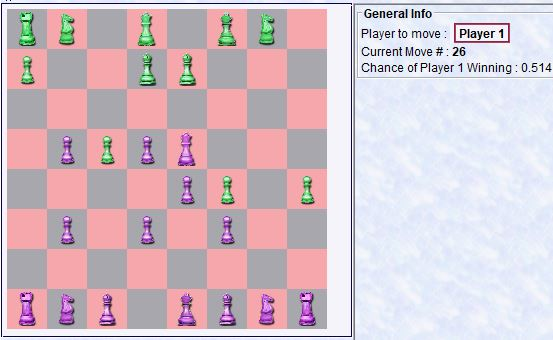
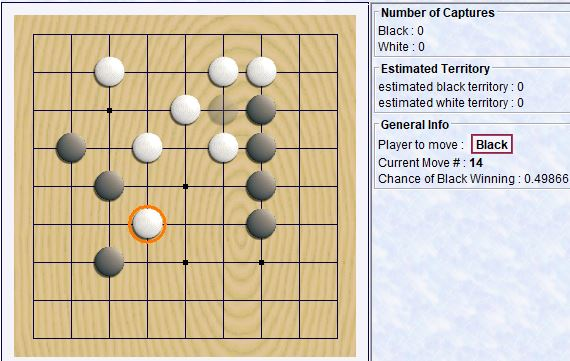
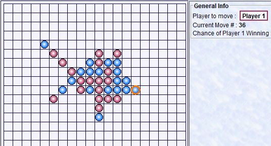
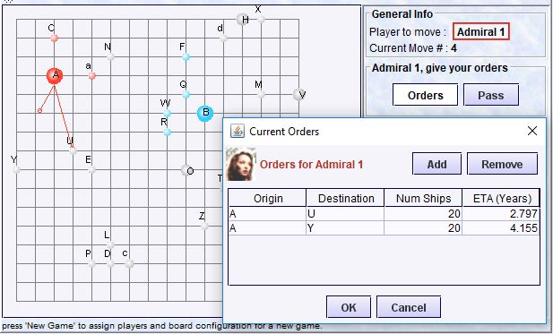

# bb4-games

[](https://github.com/bb4/bb4-games/actions/workflows/ci.yml)

A game-playing framework plus a collection of two-player and multi-player board and card games. Every game supports intelligent computer opponents — play against the machine, another person, or watch the computer play itself.

## Screenshots









## Games

| Game | Type | Description |
|------|------|-------------|
| [Chess](docs/screenshots/chess.jpg) | Two-player | Checkmate the computer's king (drag-and-drop pieces). |
| [Checkers](docs/screenshots/checkers.jpg) | Two-player | Capture all opponent pieces. |
| [Go](docs/screenshots/go.jpg) | Two-player | Capture territory; surrounded groups are removed. |
| [Go-Moku](docs/screenshots/gomoku.jpg) | Two-player | Get five in a row before the computer does. |
| [Blockade](docs/screenshots/blockade.jpg) | Two-player | Reach the opponent home base while placing walls. |
| [Hex](docs/screenshots/hex.jpg) | Two-player | Connect your two sides of the board with a path. |
| [Mancala](docs/screenshots/mancala.jpg) | Two-player | Sow stones and fill your home with more than the opponent. |
| [Tic-Tac-Toe](docs/screenshots/tictactoe.jpg) | Two-player | Classic three-in-a-row (also a minimal example for new games). |
| [Galactic Empire](docs/screenshots/galactic.jpg) | Multi-player | Conquer planets and build fleets against human and computer opponents. |
| [Poker](docs/screenshots/poker.jpg) | Multi-player | Five-card stud against human and computer opponents. |
| [Set](docs/screenshots/set.jpg) | Multi-player | Find matching card sets (no computer player — it would always win). |

## Running it

**Option 1 — installer (recommended):** download the installer for your OS from the
[latest release](https://github.com/bb4/bb4-games/releases/latest)
(macOS `.dmg`, Windows `.msi`, Linux `.deb` — one installer per game).

**Option 2 — from source:**

```bash
git clone https://github.com/bb4/bb4-games.git
cd bb4-games
./gradlew runChess          # or runGo, runGomoku, runHex, runPoker, …
./gradlew tasks --group application   # list all runnable games
```

The shared entry point is `GameApp`; Gradle creates a `run<Game>` task for each game in `appMap` (for example `./gradlew runGo -q`).

## Using it as a library

Published artifacts (latest release **2.1**):

```groovy
implementation 'com.barrybecker4:bb4-game:2.1'        // common framework
implementation 'com.barrybecker4:bb4-twoplayer:2.1'   // two-player base
implementation 'com.barrybecker4:bb4-multiplayer:2.1' // multi-player base
implementation 'com.barrybecker4:bb4-chess:2.1'       // chess + checkers
implementation 'com.barrybecker4:bb4-go:2.1'
// also: bb4-gomoku, bb4-tictactoe, bb4-mancala, bb4-hex,
//       bb4-blockade, bb4-galactic, bb4-poker, bb4-set
```

See the [releases page](https://github.com/bb4/bb4-games/releases) if you need a different version.

## What's inside

- **`com.barrybecker4.game.common`** — shared framework: board model, search/AI hooks, plugins, online client/server pieces, and the `GameApp` Swing launcher
- **`com.barrybecker4.game.twoplayer.common`** — two-player search, UI panels, and move infrastructure
- **`com.barrybecker4.game.multiplayer.common`** — multi-player turn/player infrastructure
- **Per-game packages** under `twoplayer/` (chess, checkers, go, gomoku, blockade, hex, mancala, tictactoe) and `multiplayer/` (galactic, poker, set, trivial)
- **`com.barrybecker4.game.twoplayer.comparison`** — side-by-side search comparison tool (`runGameComparisons`)

## Building from source

See the [Building bb4 Projects wiki](https://github.com/bb4/bb4-common/wiki/Building-bb4-Projects).

## License

MIT — see [LICENSE](LICENSE).
